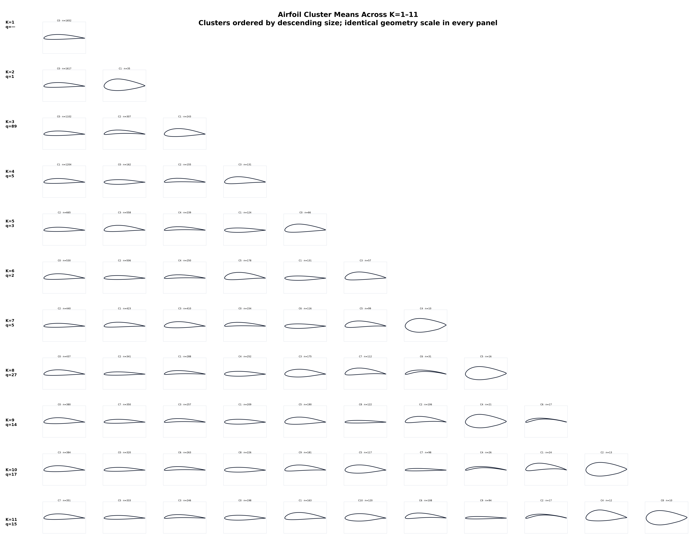

# Unsupervised Analysis of Aircraft Airfoil Shapes

This repository presents a [MARS summer research project](https://www.lancaster.ac.uk/mathematics-for-ai-in-real-world-systems/summer-internships/) on unsupervised learning for aircraft airfoil geometry. The project aims to identify groups of geometrically similar airfoils and use these groupings to guide the selection of representative registration templates. Using a dataset of 1,652 airfoils, each represented by 200 corresponding two-dimensional points, we explored registration-based deformation features, principal component analysis (PCA), K-means clustering, and Gaussian mixture models (GMMs). We compared candidate clustering configurations using statistical model-selection criteria and further evaluated potential registration templates through physical deformation measures.

The repository contains the research poster, raw and processed datasets, selected source code, model-selection and validation results, and scripts for reproducing the poster figures.

The repository contains the research poster, the raw and processed data used by the analysis, selected source code from the original research workspace, model-selection and validation artifacts, and scripts for recreating the poster figures.



## Research question

Can a collection of airfoil geometries be summarized by a small number of representative shape groups, and how sensitive are those groups to the registration template, PCA dimension, clustering model, and model-selection criterion?

The project also asks whether adding more registration templates reduces the deformation needed to align individual airfoils, and whether statistically preferred clusterings remain stable when the PCA dimension changes.

## Methods

1. Download Selig-format airfoil coordinates from the UIUC Airfoil Data Site.
2. Normalize and resample each accepted contour to 200 corresponding points.
3. Construct registration-based stationary velocity field (SVF) features using pinned airfoil contours and B-spline coefficients.
4. Apply PCA to the registration coefficient fields.
5. Apply K-means clustering to the resampled airfoil coordinates as a shape-based baseline.
6. Fit full-covariance Gaussian mixture models (GMMs) to the PCA-reduced registration coefficients across candidate numbers of clusters (K) and PCA dimensions (q).
7. Compare candidate clustering configurations using BIC, ICL, held-out log likelihood, assignment stability, cluster size, and deformation-based physical diagnostics, where applicable.
8. Examine cluster mean shapes and how membership changes across selected values of K.

## Key findings

- **Multiple shape-specific templates can reduce registration deformation.** Initial K-means experiments showed that cluster-specific mean templates reduced both Dirichlet energy and average SVF magnitude as the number of templates increased. Subsequent physical-cost analysis suggested a reduction in deformation cost around K = 8, followed by a relative plateau through K = 11.
- **Registration-derived deformation features reveal distinct airfoil shape families.** PCA and GMM clustering of registration-derived SVF coefficients identified recurring patterns of geometric variation among the 1,652 airfoils. Cluster-mean visualisations showed broad shape families that became more finely separated as the number of components increased.
- **Clustering results depend on model complexity.** BIC, ICL, and held-out log likelihood favoured different GMM component counts depending on the retained PCA dimension. Adjacent-dimension ARI analysis also showed changes in cluster assignments, indicating that no single clustering configuration was consistently preferred across all criteria.
* **Major shape families persist despite further subdivisions.** Cluster-mean and alluvial visualisations across K = 8–11 showed that several major shape families remained recognisable, while additional components introduced finer subdivisions and reassigned some airfoils.

Overall, the results suggest that data-driven shape families offer a promising basis for selecting registration templates, although further controlled comparisons are needed to determine the most appropriate number of templates.

## My contributions

I wrote and organized Python workflows represented in this project workspace for data preparation, clustering experiments, evaluation, and figure generation. I also assembled the research artifacts into this public-facing repository.

The registration method and scientific decisions were developed in the wider MARS research setting. Before using this repository in an application or publication, I will confirm any collaborator-specific attribution that is not recorded in the files themselves.

## Repository structure

```text
.
├── data/                    # Raw UIUC files and processed NumPy datasets
├── figures/
│   ├── poster/              # Figures used in, or directly underlying, the poster
│   └── generated/           # Figures produced by the lightweight figure script
├── outputs/                 # Curated tables, labels, templates, audits, and model artifacts
├── poster/                  # A1 research poster
├── scripts/                 # Analysis, downstream evaluation, and plotting programs
├── src/                     # Data, registration, clustering, and validation code
├── tests/                   # Preserved unit test from the research workspace
├── CODE_MAP.md              # Guide to the main analysis programs
├── FIGURE_MANIFEST.md       # Poster figure provenance
└── VALIDATION.md            # Checks performed while preparing this repository
```

## Data

The original UIUC archive and its extracted `.dat` files are included under `data/airfoils/raw/`. Two processed datasets are retained because they were used at different stages:

- `data/airfoils/processed/airfoils_n100_seed0.npz`: 1,654 airfoils used by the earlier direct-coordinate K-means experiment.
- `data/airfoils/processed_gabriel/airfoils_pinned_arclength_n200.npz`: 1,652 airfoils used by the main registration, PCA, GMM, and downstream shape analyses.

See [data/README.md](data/README.md) for provenance, array contents, filtering, and checksums.

## Recreating the poster figures

Create an environment and install the dependencies:

```bash
python3 -m venv .venv
source .venv/bin/activate
pip install -r requirements.txt
```

Then run:

```bash
python scripts/reproduce_poster_figures.py
```

The script redraws the poster charts from saved CSV/NPY/NPZ artifacts and writes them to `figures/generated/`. It does not rerun registration or refit PCA/GMM models. The original experiment programs are retained in `src/` and `scripts/` for inspection.

## Scope of the included outputs

The repository includes the data and scientific artifacts needed to inspect the analysis and recreate the poster figures: model-selection grids, PCA state, the global-mean coefficient matrix, assignments, templates, summary tables, audits, and figure inputs.

Per-airfoil registration checkpoint directories and the ten large branch-level coefficient matrices are not included. They were approximately 1 GB of mechanically generated intermediate files and are not inputs to the poster plotting scripts. Their generation code, configurations, summaries, and validation reports are included.

## Limitations

- The early K-means inertia figure uses 1,654 airfoils, while the main Gabriel pipeline uses 1,652 airfoils selected through a separate validation procedure. Results from these two datasets should not be treated as if they came from an identical sample.
- The single-global-mean registration experiment recorded 1,651 diagnostically valid registrations out of 1,652; downstream code explicitly records the excluded case where applicable.
- The combined `K=2–11` deformation figure uses different `q`-selection interpretations for `K=2–7` and `K=8–11`.
- BIC, ICL, held-out likelihood, cluster stability, and physical deformation cost answer different questions and need not select the same model.
- Deformation energy and SVF magnitude are registration diagnostics, not lift, drag, or other aerodynamic measurements.
- The repository supports reproducing the poster figures from saved analysis outputs. The full registration pipeline is computationally intensive and has not been independently rerun end-to-end in a fresh environment.

## Poster

The full poster is available at [poster/MARS_Leo_poster_A1_landscape.pdf](poster/MARS_Leo_poster_A1_landscape.pdf).

