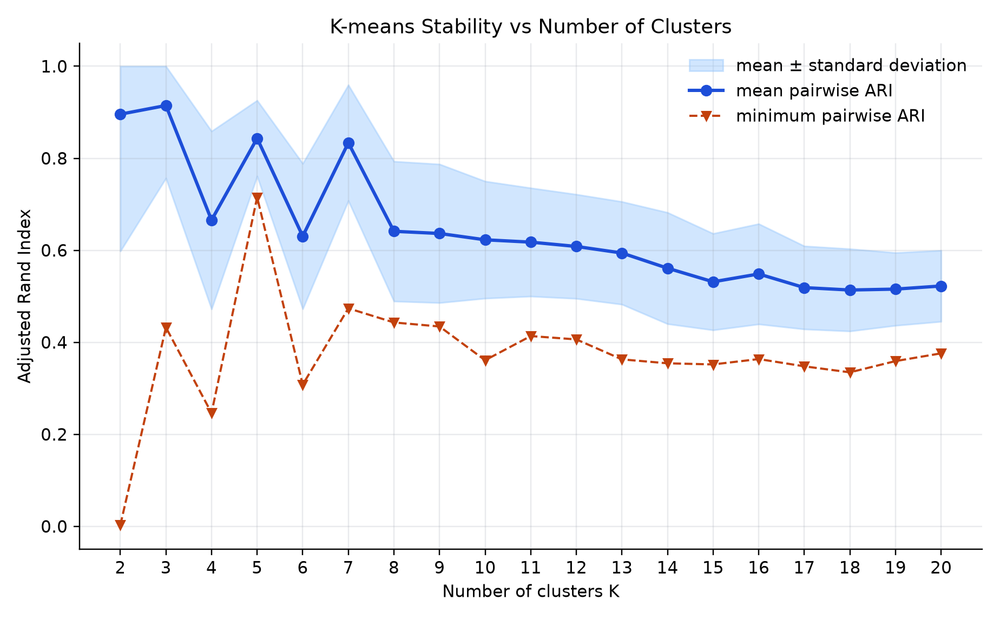
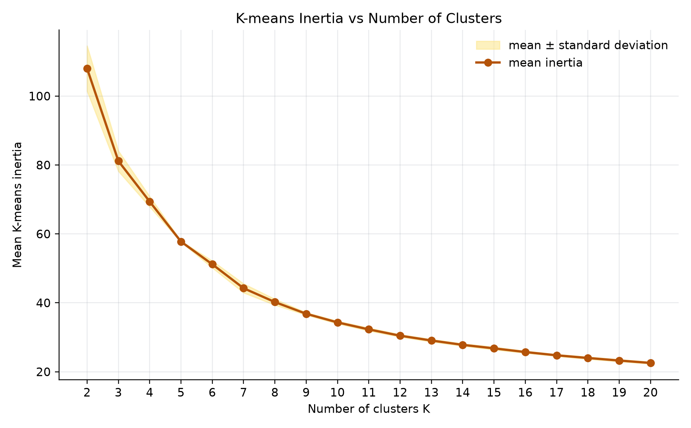
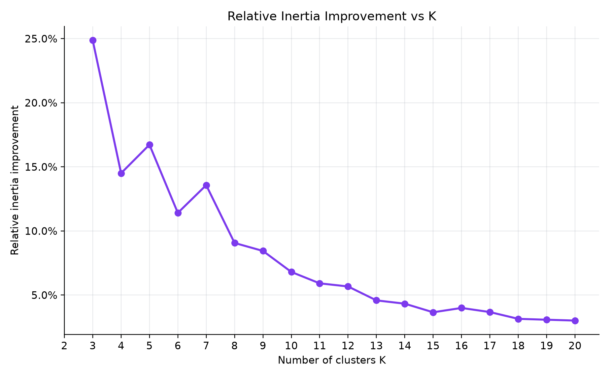
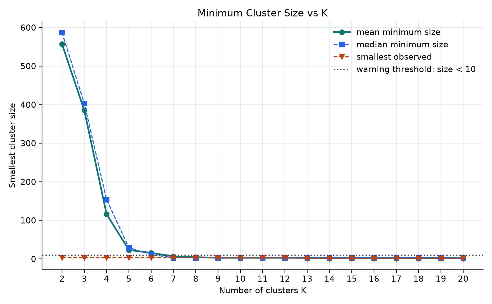

# 直接坐标 K-means 稳定性实验报告

## 技术摘要

本实验在既有的 1,654 个预处理翼型上，直接使用 200 个对应二维点的 400 维展平坐标运行 K-means；没有运行注册、PCA、GMM，也没有使用速度场。`K=2…20` 各用 20 个显式随机种子和单次 k-means++ 初始化，共完成 380 次独立拟合，全部收敛且均得到恰好 K 个非空簇。

稳定性最高的是 **K=3**（平均成对 ARI 0.915），其次为 K=2（0.896）、K=5（0.843）和 K=7（0.834）。但 K=2 的最差 ARI 仅 0.003，说明其高均值被一次明显不同的初始化解打破；相比之下，**K=5 的最差 ARI 为 0.715，是稳定性峰值中最强的最坏情形表现**。平均 ARI 在 K=3、5、7 形成三个清楚的局部峰值，K≥8 后总体下降并在约 0.51–0.64 范围内形成较低平台。

惯性曲线的简单归一化弦距膝点为 **K=7**。相对惯性改善从 K=7 的 13.6% 降到 K=8 的 9.1%，K=10 后低于 7%，K=13 后低于 5%，因此主要的收益递减区大致位于 **K=7–10**。稳定性与肘部并不指向完全相同的选择：K=7 同时是局部稳定性峰值和膝点，但其最小簇存在明显病态性。

综合判断，直接 K-means 最可辩护的主候选范围是 **K=3–5**，其中 K=5 在稳定性、惯性收益和簇规模之间最均衡。**K=6–8 可保留为次级探索范围**，尤其 K=7 与此前 q≈19–20 的 GMM 筛选所提示的 K=6–8 一致；但直接 K-means 在 K=7 的 20 次运行中有 17 次出现小于 10 个样本的簇、18 次出现小于 1% 的簇，因此不能仅凭肘点或与 GMM 的一致性推荐 K=7。

## 稳定性呈现交替局部峰值，而非单一平台

主图显示平均成对 ARI、总体标准差以及最小 ARI。K=3、5、7 分别形成局部峰值；K=4 和 K=6 明显回落。K=5 的平均 ARI 为 0.843、标准差 0.082、中位数 0.824，且 190 个比较的范围为 0.715–1.000。K=7 的平均值略低（0.834），离散性更高（标准差 0.126），最小值降至 0.474。

最高平均稳定性顺序为：K=3（0.915）、K=2（0.896）、K=5（0.843）、K=7（0.834）。最差 ARI 特别差的 K 包括 K=2（0.003）、K=4（0.246）和 K=6（0.308）；K=10–20 的最小 ARI也只有约 0.335–0.414。K=5 是唯一最小 ARI 超过 0.7 的候选。

## 惯性主要在 K=7–10 进入收益递减区

平均惯性从 K=2 的 108.010 单调下降至 K=20 的 22.561。简单膝点算法把最大弦距定位在 K=7；该结果只作为曲线诊断，不是“真实簇数”的估计。

从 K−1 增加到 K 的平均惯性相对改善依次在 K=3、5、7 出现较大值（24.9%、16.7%、13.6%）。之后改善降至 K=8 的 9.1%、K=10 的 6.8%、K=13 的 4.6%，并在 K=18–20 约为 3.0–3.1%。这支持把 K=7 附近视为主肘部、K=8–10 视为过渡到明显递减收益的区域。

## 小簇使 K=7 及更高 K 的吸引力明显下降

诊断阈值为簇大小 `<10` 或簇占比 `<1%`，仅作警告而不自动否决 K。所有 K 至少有一个种子触发警告，原因是少数初始化会把 3 个极端样本单独分成小簇；因此 K=2、3 的高稳定性均值也不是完全无条件的。

K=5 的平均最小簇规模为 23.2，中位数为 29，20 次中有 4 次出现 `<10` 或 `<1%` 的簇。K=6 的平均最小簇规模降至 15.45，10 次出现 `<10`，11 次出现 `<1%`。K=7 的平均最小簇仅 6.7，中位数 3；K≥9 的每一次运行都出现小于 10 且小于 1% 的簇。K=13 起甚至观察到单样本簇。因此高 K 的部分惯性改善来自隔离极少数样本，而不一定代表稳健的翼型家族划分。

## 数据、表示与指标定义

- 输入文件：`data/airfoils/processed/airfoils_n100_seed0.npz`
- 输入 SHA-256：`9ec711663c4d3bde214f2ac6359591b644e5d66e849811c9fb728b593a5df2d7`
- 数据形状：`(1654, 200, 2)`；每个翼型 100 个上表面点和 100 个下表面点。
- 所有样本维数相同；NaN 数为 0，无穷值数为 0。
- 所有 200 个 x 坐标维度在翼型之间逐元素完全相同，因此按定义其跨样本方差为零。直接浮点 `np.var` 的最大残差为 `1.07×10⁻²⁷`，属于求和舍入误差。
- 固定 x 网格与一致的上下表面索引表明点对应关系已经建立；本实验没有重新预处理原始文件。
- 主表示按 NumPy C-order 展平为 `[point0_x, point0_y, point1_x, point1_y, …]`，维度为 400。
- 对固定 K 的 20 个解计算全部 `C(20,2)=190` 个 ARI，不进行标签对齐。标准差使用总体定义（`ddof=0`）。

## K-means 配置与复现细节

使用 `sklearn.cluster.KMeans` 1.9.0，配置为 `init="k-means++"`、`n_init=1`、`max_iter=1000`、`tol=1e-6`、`algorithm="lloyd"`，并逐次显式设置 `random_state=0…19`。这保证每行结果代表一个独立初始化，而不是把多个初始化隐藏在一个拟合结果中。

可选的小型 sanity check 在诊断膝点 K=7、seed=0 上仅使用 200 个 y 坐标重新拟合。完整 400 维与 y-only 标签的 ARI 为 1.000，两者惯性均为 43.449413；10,000 对抽样距离的最大平方距离差仅 `1.78×10⁻¹⁵`。这验证恒定 x 维不改变距离结构，同时主实验仍完整使用 400 维表示。

## 与此前 GMM 筛选的定性比较

此前 q≈19–20 的 PCA-GMM 筛选把 K=6–8 视为重要候选区。本次直接 K-means 的惯性膝点 K=7 和局部稳定性峰值确实与该范围重叠，但簇规模诊断给出强烈反证：K=7 大多数初始化产生极小簇，K=8 更严重。因此两种方法不是完全一致；直接 K-means 更支持 K=3–5 的稳健主范围，而把 K=6–8 降为需要进一步解释极端样本和小簇的次级范围。这里没有把 K-means 结果强行调整为匹配 GMM，也不把任何 K 声称为普适的翼型家族真值。

## 验证、限制与输出完整性

- 19 个 K、每个 20 次，共 380 次拟合；每个 K 恰有 190 个 ARI。
- 所有 ARI 和惯性均为有限值；所有拟合收敛；每次标签均含恰好 K 个非空簇。
- 输入文件运行前后 SHA-256 相同。
- 运行前后比较所有既有顶层输出目录的修改时间，没有变化；PCA、GMM、注册输出未被修改。
- 拟合、汇总和绘图计时为 5.416 秒（单线程 BLAS 环境）；最终输出文件表观大小为 1,283,570 字节，磁盘占用约 1,284 KiB。
- K-means 只度量当前对应坐标下的欧氏平方距离；结果对极端翼型敏感，且稳定性只描述随机初始化的一致性，不证明簇具有物理、气动或生成机制上的真实性。

## 建议的下一步（等待批准）

在不开展新实验的前提下，本次结果支持优先审阅 K=5，并把 K=3–5 作为直接 K-means 的候选范围；若后续获批，可再针对 K=6–8 的极小簇检查对应翼型是否为真实稀有族或离群样本。本任务在此停止，不运行注册、PCA-GMM、模板构造或气动优化。

## 仍需回答的问题

- K=2–8 中反复形成的 3 样本小簇是否由同一组极端翼型构成？
- 若对离群值采用预先声明、与 K 无关的稳健处理，K=5 与 K=7 的稳定性和簇规模结论是否改变？
- 直接坐标欧氏距离形成的候选族是否具有可解释的几何或气动差异？这些问题不属于本次实验，需另行批准。
