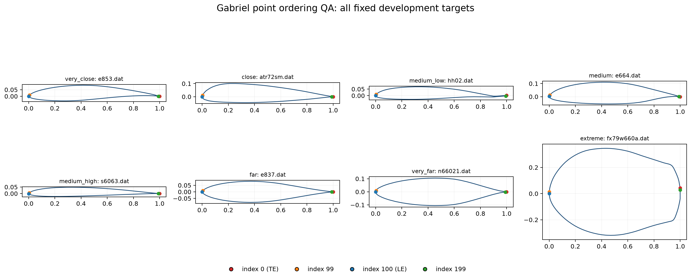
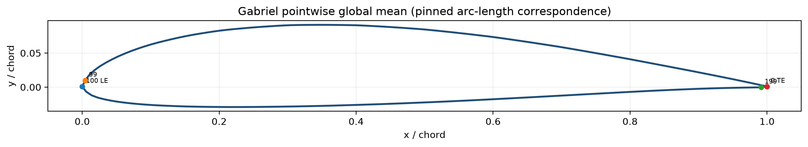
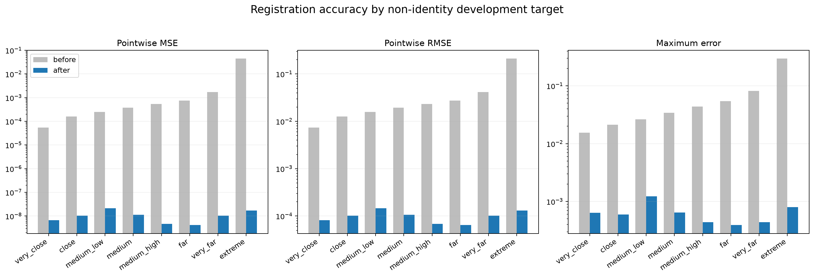
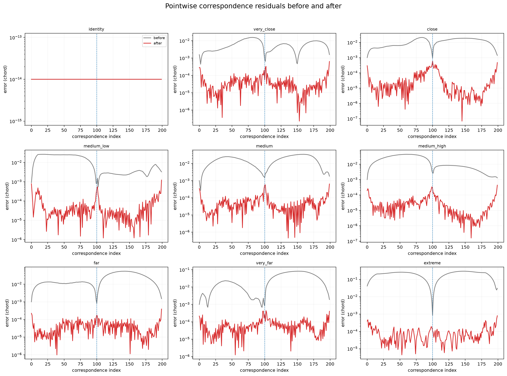
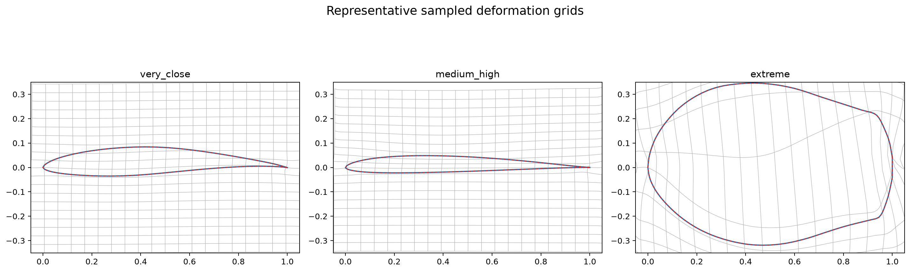
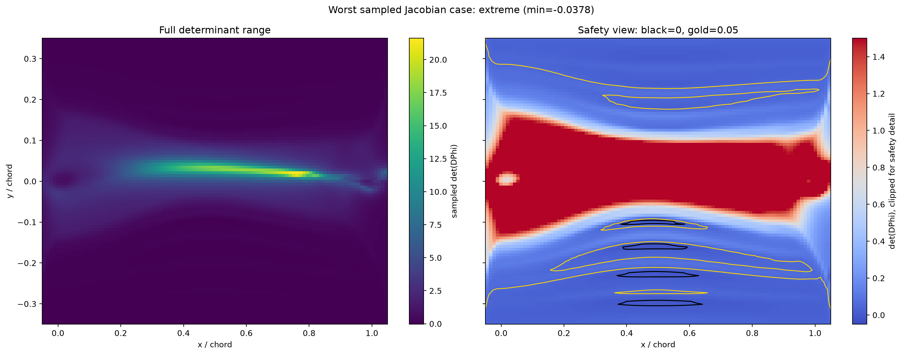
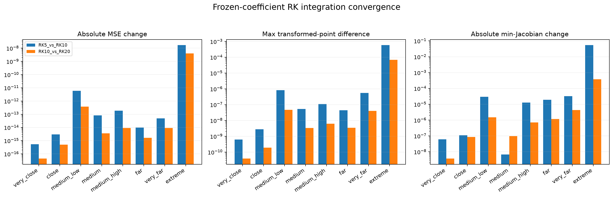
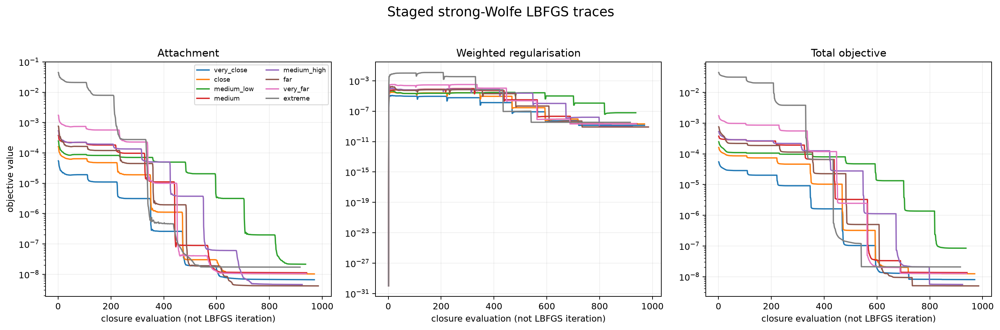

# Gabriel 固定对应翼型注册：开发子集基准

## 技术摘要

本实验从原始 UIUC Selig 文件独立建立 Gabriel 参数化数据集，共检查 `1665` 个文件，Gabriel 原始标量过滤通过 `1657` 个，附加的无修复几何验证后保留 `1652` 个。旧余弦数据集未被用作注册输入，也保持 SHA-256 不变。

独立源码交叉检验对全部 `1652` 个保留轮廓重新调用 Gabriel 原始重采样，并比较 cubic basis、local velocity、RK4 flow 与 smoothness；所有最大差异均为 `0.0`。

固定 8 个非恒等开发目标均按文件名匹配成功；成功注册 `8/8` 个。非恒等目标最终点级 MSE 中位数/最差值为 `1.041e-08` / `2.154e-08`，RMSE 中位数为 `1.020e-04`，最大单点误差的最差值为 `1.228e-03`。这些数值属于 Gabriel 等弧长对应，不能与旧余弦 chordwise 对应的 MSE 直接作同一目标比较。

最弱 sampled Jacobian 出现在 `extreme`，最小值 `-0.0378`，非正比例 `1.26%`。因此 Gabriel 原法在本开发集上不能判定为数值安全；同时最坏 RK5→RK10 的 MSE 变化为 `1.700e-08`，说明极端案例的 RK5 也未充分收敛。9 个案例优化加复测诊断的计时组件合计 `42.6` 秒。

结论是：该方法在对应误差上很准确、速度场正则量有限、单目标计算可行，但 `extreme` 的 sampled folding 与积分敏感性否决了“按当前原设置直接扩大到完整人群”的建议。下一步若获批准，应先单独处理安全性与 RK 时间离散，而不是立即进行全体注册。

## 新数据集保持了 Gabriel 的 TE/LE 锚点与等弧长索引

Gabriel 读取每个文件时跳过首行，只解析其后恰含两个空白分隔字段的行；按文件名排除 flap/main-flap/slat/30p-30n，随后执行点数、坐标幅度、弦长和归一化 y 范围过滤。坐标按 `(coords-[min(x),0])/(max(x)-min(x))` 归一化，不进行旋转或 y 平移。

前缘取第一个最小 x 点。上表面使用原始 `TE→LE` 片段，按 100 个等间隔 polyline 弧长位置采样并排除 LE 端点；下表面从 LE 开始并显式连接首个 TE 点，同样取 100 个位置并排除闭合 TE。最终 index 0 为 TE、index 100 为 LE，index 199→0 构成闭合段，没有第 201 个重复点。

所有保留轮廓均为 `(200,2)` float64，锚点、表面方向、有限性、零长度段、自交和方向检查全部通过。上/下表面相邻弦段长度 CV 的最大值分别为 `3.892e-02` / `6.414e-02`；采样位置本身严格来自等间隔 polyline 弧长，跨越原始折点时相邻欧氏弦长允许略短。

图中明确标出 0、99、100、199，并以虚线表示 199→0 闭合段；它用于验证顺序而非注册精度。

## 总体对账显示两种预处理并非完全相同的人群

新数据集中 `1644` 个文件名可唯一映射到旧 1654 集；仅 Gabriel 集有 `8` 个，仅旧集有 `10` 个。不存在被执行的方向修复；不符合预期遍历或几何有效性的文件被明确拒绝。

主要拒绝原因：

- `excluded_filename_token`：5 个
- `validation_reject:self_intersection`：4 个
- `reference_filter:short_or_nonpositive_chord`：2 个
- `reference_filter:normalised_y_exceeds_0.5`：1 个
- `validation_reject:unexpected_or_reversed_selig_traversal`：1 个

完整逐文件状态、警告和哈希见 `conversion_manifest.csv`；拒绝项见 `conversion_failures.csv`。重复原始 TE、有限厚度 TE、多个或近似多个最小 x 点均被记录；仅当最终参数化仍满足确定性几何验证时才保留。

## 新全局均值是唯一注册源

新均值由全部 `1652` 个有效 Gabriel 轮廓逐点平均得到。形状 `(200,2)`，有限性 `True`，index 0 TE 与 index 100 LE 检查均通过，自交数 `0`。旧余弦均值未参与拟合。

均值图同时显示四个关键索引；均值轮廓保持与个体一致的逆时针 TE-upper-LE-lower-TE 顺序。

## Gabriel 原法在开发目标上的精度

| 案例 | 文件 | 状态 | 点级 MSE | 点级 RMSE | 最大误差 | min det(J) | 优化+诊断秒 |
|---|---|---|---|---|---|---|---|
| identity | GLOBAL_MEAN | completed | 0.000e+00 | 0.000e+00 | 0.000e+00 | 1.0000 | 0.3 |
| very_close | e853.dat | completed | 6.628e-09 | 8.141e-05 | 6.342e-04 | 0.6806 | 5.3 |
| close | atr72sm.dat | completed | 1.029e-08 | 1.014e-04 | 5.965e-04 | 0.6705 | 5.4 |
| medium_low | hh02.dat | completed | 2.154e-08 | 1.468e-04 | 1.228e-03 | 0.2357 | 5.3 |
| medium | e664.dat | completed | 1.127e-08 | 1.061e-04 | 6.421e-04 | 0.5024 | 5.2 |
| medium_high | s6063.dat | completed | 4.607e-09 | 6.787e-05 | 4.377e-04 | 0.2986 | 5.1 |
| far | e837.dat | completed | 4.151e-09 | 6.443e-05 | 3.909e-04 | 0.3268 | 5.5 |
| very_far | n66021.dat | completed | 1.054e-08 | 1.026e-04 | 4.404e-04 | 0.1843 | 5.3 |
| extreme | fx79w660a.dat | completed | 1.724e-08 | 1.313e-04 | 7.962e-04 | -0.0378 | 5.1 |

点级 MSE 定义为 200 个对应点的二维平方距离平均；coordinate-wise MSE 是 400 个标量残差的平均，因此严格等于点级 MSE/2。TE 区域固定为索引 0–9 与 190–199，LE 为 90–109，mid 为其余 160 点。identity 单独报告，不进入上述非恒等汇总。

柱图使用对数轴展示拟合前后误差；由于三个指标单位和量级不同，分别放在独立面板，避免共享尺度误导。

逐点图用于定位残差是否集中在前缘、后缘或中部；完整数值保存在 `per_point_residuals.csv`。

## 速度场平滑度与变形规模需使用两个不同口径

默认模型有 `1800` 个标量参数。Gabriel 的 `R` 是 30×30 系数阵列在两个格轴上的未归一化一阶差分平方和；它不是连续 Sobolev/RKHS 范数，也不能跨网格分辨率直接比较。本实验另在统一 101×101 物理网格上计算速度梯度平方的梯形积分作为 Dirichlet 诊断，并单独计算分量 Laplacian 平方积分作为弯曲诊断。

非恒等案例 raw coefficient smoothness 中位数为 `1.637e-02`，物理 Dirichlet 诊断中位数为 `1.815e-02`，平均源点位移中位数为 `1.699e-02`。这些量解释变形规模和平滑度，但没有进入附件项以外的新目标。

代表性网格按初始难度选择 easy/median/hard 案例，只显示同一个固定空间网格经最终流映射后的形状。

## sampled Jacobian 未参与优化，但揭示数值安全边界

所有案例中的折叠案例数为 `1`（`extreme`）；变形后轮廓自交案例数为 `0`；轨迹曾离开控制格范围的案例数为 `0`。Gabriel 原目标没有 Jacobian barrier，本实验没有加入。

热图覆盖固定的 `[-0.05,1.05]×[-0.35,0.35]` 范围。边界处的有限差分和 B-spline 支撑截断会影响极值解释，因此结论限定为 sampled numerical evidence。

## RK5 与更细积分的差异量化了时间离散误差

冻结系数后，RK5→RK10 的最大源点差异在所有案例中不超过 `5.845e-04`，最大 MSE 变化 `1.700e-08`；RK10→RK20 分别不超过 `6.772e-05` 与 `4.076e-09`。极端案例主导这些上界，故 RK5 对它不充分；逐案例差异见 `integration_convergence.csv`。

图中比较的是同一最终速度场的积分精度，不包含重新优化，因此可以直接归因于 RK 步数。

## 分阶段 L-BFGS 严格复现自适应正则策略

每个案例从零系数开始。第一周期固定 λ=0.1；后续周期只在周期开始计算一次 `min(0.2·D/max(R,1e-12),0.1)`，随后在该周期内保持不变。每周期使用 strong-Wolfe L-BFGS，最多 100 次 optimizer iteration；closure evaluation 另行计数，二者没有混称。

非恒等案例 closure evaluation 中位数为 `940`，优化时间中位数为 `5.1` 秒，优化加同路径诊断复测的组件时间中位数为 `5.3` 秒。PyTorch 提供每周期 iteration/function-evaluation 计数，但不提供可靠的分类终止原因，因此报告不宣称比现有信息更强的“收敛”。

轨迹横轴明确是 closure evaluation。周期切换会改变 λ，因此总目标曲线在边界处不必连续。

## 限制、稳健性与是否值得扩大

最终验证状态为 `PASS`。本实验只注册 9 个开发案例；数据转换虽然覆盖全部原始文件，但没有对其余 `1644` 个有效目标做注册。因对应参数化不同，本报告没有把新 MSE 与旧 Stage 4 MSE 当作同一统计量比较。

当前不建议直接进行后续完整人群注册：开发集中已出现 sampled folding，而且极端案例的 RK5 时间离散误差不可忽略。精度和运行时间本身支持继续方法研究，但没有覆盖安全性失败。

## 建议的下一步

- 在获得批准前保持停止；不启动完整人群注册、PCA/GMM 或模板构建。
- 若批准下一阶段，优先研究极端案例的 folding 与 RK5 误差；这属于新的方法开发，必须另行授权。
- 只有安全与积分充分性重新验证通过后，才估算并考虑完整人群运行。

## 仍待回答的问题

- 开发子集的安全性和耗时能否代表整个 Gabriel 人群中的极端几何？
- 采用 Gabriel 等弧长对应后，前缘/后缘残差是否在完整人群中呈系统性结构？
- 在不改变 Gabriel 忠实基线结论的前提下，何种安全机制能消除极端案例的局部折叠？

本阶段到此停止。没有运行完整数据集注册，没有运行 PCA/GMM、模板选择或气动优化，也没有 commit/push。
